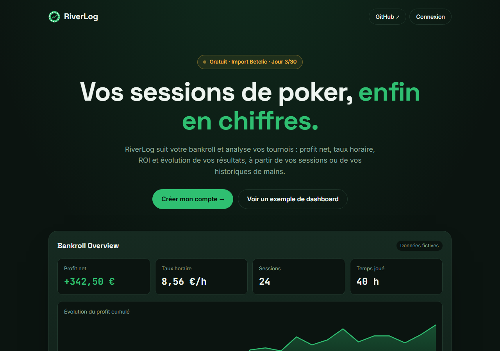

# RiverLog · Suivi de bankroll poker

> Jour 03 du défi **30 jours, 30 projets** · Laravel, Blade, MySQL et Chart.js · 🟢 **En ligne : [riverlog.projectp.fr](https://riverlog.projectp.fr)**



RiverLog suit votre bankroll poker et analyse vos tournois : **profit net, taux horaire, ROI et évolution des résultats**, à partir de sessions saisies à la main ou d'historiques de mains importés.

Le cœur du projet n'est pas le CRUD, mais **des statistiques fiables** : cartes, courbes et tableaux utilisent toujours le même ensemble de données filtrées, calculé côté serveur, et chaque main importée est contrôlée.

📄 Le détail est dans le [cahier des charges](CAHIER_DES_CHARGES.md).

## Fonctionnalités

- **Comptes** : inscription, connexion ; chacun ne voit que ses propres données. Une **démo publique** en lecture seule montre un dashboard et des tournois fictifs (`/demo`).
- **Sessions** : date, format (Cash Game, MTT, Sit & Go, Spin), durée, résultat et notes. Ajout, modification, suppression.
- **Dashboard** : profit net, taux horaire, sessions, temps joué et courbe du profit cumulé, avec des **filtres** par format, période et résultat gardés dans l'URL.
- **Import Betclic** : fichiers `.txt` ou `.zip`, doublons ignorés, réimport sans risque. Les tournois proches sont regroupés en **sessions automatiques**.
- **Tournois** : ROI, victoires, places finales, conversion en heads-up, résultats par multiplicateur et par buy-in, ROI hors jackpots.
- **Détail d'un tournoi** : chaque main avec cartes, board, tapis en big blinds et jetons gagnés ou perdus.
- **Défis du jour** (`/defis`), les mêmes pour tout le monde, renouvelés à minuit :
  - *Qui est devant ?* : estimer l'équité de deux mains à tapis (évaluateur de mains et calcul d'équité maison) ;
  - *Le calcul du jour* : cotes du pot, outs, ROI, taux horaire, bankroll, avec l'explication de chaque réponse ;
  - *Défi discipline* : un objectif de bankroll par jour (stop-loss, pause, jour de repos…), vérifié sur les vraies sessions du compte, avec une série de jours réussis.
- **Qualité** : 92 tests automatisés sur MySQL, tests lancés par GitHub Actions à chaque push, déploiement automatique par Coolify.

## Lancer en local

Prérequis : PHP 8.3 ou plus récent avec l'extension `pdo_mysql` (et `zip` pour importer des archives), Composer, et un serveur **MySQL 8.4** (sous Windows : `winget install Oracle.MySQL`).

**1. Créer les bases et l'utilisateur** (dans `mysql -u root -p` ou MySQL Workbench) :

```sql
CREATE DATABASE riverlog CHARACTER SET utf8mb4 COLLATE utf8mb4_unicode_ci;
CREATE DATABASE riverlog_test CHARACTER SET utf8mb4 COLLATE utf8mb4_unicode_ci;
CREATE USER 'riverlog'@'localhost' IDENTIFIED BY 'un-mot-de-passe';
GRANT ALL PRIVILEGES ON riverlog.* TO 'riverlog'@'localhost';
GRANT ALL PRIVILEGES ON riverlog_test.* TO 'riverlog'@'localhost';
```

**2. Installer l'application :**

```bash
composer install
cp .env.example .env          # puis renseigner DB_PASSWORD
php artisan key:generate
php artisan migrate --seed    # tables + compte de démonstration
php artisan serve
```

Puis ouvrir http://127.0.0.1:8000 (la démo publique est sur `/demo`).

**Tests** : `php artisan test`. Ils utilisent la base `riverlog_test`, vidée à chaque test : la base de l'application n'est jamais touchée.

## Mise en ligne

RiverLog est hébergé sur un VPS avec **[Coolify](https://coolify.io)** : **https://riverlog.projectp.fr**. Coolify redéploie le site à chaque push sur `master`.

| Élément | Réglage dans Coolify |
| --- | --- |
| **Application** | Dépôt GitHub `PierreWZK/RiverLog`, build pack **Dockerfile**, port 80 |
| **Image** | [`Dockerfile`](Dockerfile) : FrankenPHP (Caddy + PHP 8.3). L'étiquette `1-php8.3` suit les correctifs de PHP : un redéploiement **sans cache** récupère la dernière version corrigée |
| **Serveur web** | [`docker/Caddyfile`](docker/Caddyfile) et [`docker/php.ini`](docker/php.ini) : limite d'envoi de 16 Mo pour les imports, fichiers cachés jamais servis, version de PHP masquée |
| **Après chaque déploiement** | `php artisan migrate --force && php artisan optimize` |
| **Base de données** | MySQL dans Coolify (`riverlog_database`), reliée par la variable `DB_URL` |
| **Variables** | `APP_KEY`, `APP_URL`, `APP_ENV=production`, `APP_DEBUG=false` (indispensable : sinon une erreur afficherait les mots de passe), `SESSION_SECURE_COOKIE=true`… ; jamais versionnées |
| **HTTPS** | Certificat Let's Encrypt géré par Coolify ; Laravel fait confiance à son proxy (`trustProxies` dans `bootstrap/app.php`) pour que les liens restent en `https://` |

`--force` est obligatoire en production : Laravel refuse sinon de lancer les migrations, par sécurité.

### Intégration continue

Le workflow [`.github/workflows/main.yml`](.github/workflows/main.yml) lance les tests à chaque push et pull request : PHP 8.3 et une base MySQL 8.4 temporaire sont installés sur GitHub, puis tous les tests tournent.

## Technologies

Laravel 13, Blade, MySQL 8.4, Chart.js. Hébergement Coolify (image Docker FrankenPHP), tests sur GitHub Actions. Polices Space Grotesk, Inter et JetBrains Mono (Google Fonts).
